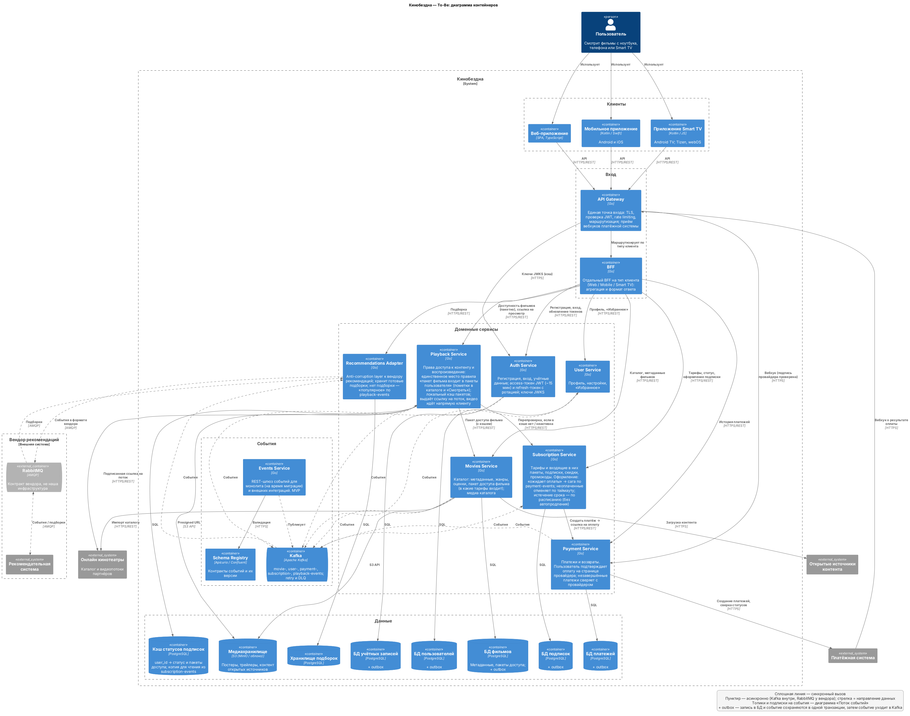

## Изучите [README.md](.\README.md) файл и структуру проекта.

# Задание 1

1. Спроектируйте to be архитектуру КиноБездны, разделив всю систему на отдельные домены и организовав интеграционное взаимодействие и единую точку вызова сервисов.
Результат представьте в виде контейнерной диаграммы в нотации С4.
Добавьте ссылку на файл в этот шаблон
[ссылка на файл](docs/architecture/to-be-containers.puml)

## Решение

Все диаграммы — C4-PlantUML (стандартная библиотека PlantUML, `!include <C4/...>`), рядом с исходником лежит отрисованный PNG.

| Диаграмма | Исходник | Картинка |
|---|---|---|
| **To-Be: диаграмма контейнеров (основной результат)** | [to-be-containers.puml](docs/architecture/to-be-containers.puml) | [PNG](docs/architecture/to-be-containers.png) |
| Поток событий через Kafka (детализация асинхронного взаимодействия) | [event-flow.puml](docs/architecture/event-flow.puml) | [PNG](docs/architecture/event-flow.png) |
| Сценарий мобильного пользователя: подготовка каталога → регистрация → вход → рекомендации → покупка подписки → просмотр платного фильма партнёра или открытого из нашего S3 (C4 Dynamic) | [scenario-mobile.puml](docs/architecture/scenario-mobile.puml) | [PNG](docs/architecture/scenario-mobile.png) |
| Переходное состояние, этап 1: Strangler Fig | [transition-stage1.puml](docs/architecture/transition-stage1.puml) | [PNG](docs/architecture/transition-stage1.png) |



### Домены и сервисы

| Сервис | Ответственность | Хранилище |
|---|---|---|
| Auth Service | Регистрация, вход, учётные данные; выпуск access-токена (JWT) и refresh-токена с ротацией; ключи JWKS | PostgreSQL |
| User Service | Профиль, настройки, «Избранное»; профиль создаётся по событию регистрации | PostgreSQL |
| Movies Service | Каталог: карточки фильмов (метаданные, жанры, оценки, пакет доступа, источник — партнёр и внешний id или наш S3); импорт каталога партнёров, загрузка контента открытых источников. Видео партнёров не хранит | PostgreSQL + S3 (медиа) |
| Subscription Service | Тарифы и входящие в них пакеты, подписки, скидки, промокоды; сага оформления | PostgreSQL |
| Payment Service | Платежи и возвраты, интеграция с платёжной системой, приём вебхуков, сверка статусов | PostgreSQL |
| Playback Service | Права доступа к контенту (доступность фильмов для каталога и проверка перед просмотром), выдача ссылки на поток | PostgreSQL (копии пакетов пользователей и фильмов) |
| Recommendations Adapter | Anti-corruption layer к внешней рекомендательной системе, хранение подборок | PostgreSQL |
| Events Service | REST-шлюз событий для монолита (на время миграции) и внешних интеграций; MVP задания 2 | — |

### Единая точка вызова

- **API Gateway** — единственный вход снаружи: TLS, проверка JWT (локально, по кэшированным ключам JWKS из Auth), rate limiting, маршрутизация, приём вебхуков платёжной системы.
- **Токены.** Auth выдаёт пару: access-токен в формате JWT (~15 мин, подписан закрытым ключом Auth, содержит только `user_id` и служебные поля) и refresh-токен (случайная строка, хэш хранится в БД Auth, ротация при каждом обмене, повторное предъявление → отзыв цепочки). Gateway проверяет access локально по открытым ключам JWKS, не обращаясь к Auth; истёкший access клиент меняет на новую пару по refresh. Тариф и пакеты в токен не кладутся — права на контент проверяет Playback по актуальным данным подписки.
- **BFF** — отдельный на каждый тип клиента (Web / Mobile / Smart TV): разные интерфейсы и объём данных, агрегация ответов нескольких сервисов. На диаграмме показан одним блоком, чтобы не дублировать связи.

### Интеграционное взаимодействие

- **Синхронно (REST)** — путь пользователя: клиент → Gateway → BFF → сервисы. Kafka не используется для ответа пользователю.
- **Асинхронно (Kafka)** — доменные события между сервисами: `user-events`, `movie-events`, `payment-events`, `subscription-events`, `playback-events`; retry-топики и DLQ; контракты событий — в Schema Registry. Kafka — единственная внутренняя шина.
- **Outbox** у всех сервисов, публикующих события по изменению своей БД: запись и событие сохраняются в одной транзакции, затем событие уходит в Kafka. Потребители идемпотентны.
- **Внешние системы**: платёжная система (создание платежей, вебхуки, сверка), онлайн-кинотеатры (импорт каталога, подписанные ссылки на поток), открытые источники контента, вендор рекомендаций (асинхронно через его RabbitMQ — часть внешнего контракта, не наша инфраструктура).

### Ключевые решения

1. **Своя БД у каждого сервиса.** Общая БД монолита — только переходный этап.
2. **Подписки отдельно от платежей.** Подписка — права доступа (частое чтение), может возникать без оплаты (промокод, пробный период); платёж — деньги. Связь через `payment-events`.
3. **Сага оформления подписки (хореография):** Subscription создаёт подписку «ожидает оплаты» и вызывает Payment → пользователь платит на странице провайдера → вебхук → `PaymentSucceeded` → подписка активирована. Отказ или таймаут → подписка отменена. Payment сверяет незавершённые платежи с провайдером. Автопродления нет: подписка на срок, по истечении Subscription публикует «истекла».
4. **Права на контент.** Соответствие «тариф → пакеты» хранит Subscription и публикует пакеты пользователя в `subscription-events`; Movies хранит пакет каждого фильма; Playback проверяет, что пакет фильма входит в пакеты пользователя. Открытый контент (из открытых источников, хранится в нашем S3) входит в пакет «Бесплатный» и доступен любому вошедшему пользователю без подписки. Playback — **единственное место** этого правила: и пометки «входит в подписку» в каталоге (BFF запрашивает у Playback доступность списка фильмов), и решение при нажатии «Смотреть». Так экран и просмотр не могут разойтись, а показ каталога не нагружает Subscription.
5. **Playback не зависит от Subscription и Movies на горячем пути:** держит локальные копии «пользователь → пакеты» из `subscription-events` и «фильм → пакет и источник» из `movie-events` (топики с ключом и compaction — копии можно восстановить перечитыванием). Изменения подписки или пакета фильма доходят за секунды, без TTL. Если записи нет (только что оплатил, фильм только что добавлен) или подписка неактивна — синхронный запрос к владельцу данных (Subscription / Movies).
6. **Видео не идёт через наш кластер:** Playback выдаёт подписанную временную ссылку, клиент смотрит напрямую с CDN партнёра или из нашего S3.
7. **Рекомендации асинхронно** (условие кейса). Подборки хранятся у нас, сбой вендора не влияет на пользователя; для новых пользователей — «популярное» по `playback-events`.
8. **Отказались от центрального сервиса событий** (всё через Events Service): единая точка отказа, невозможен outbox, потребителям всё равно нужны consumer groups и replay. Единообразие обеспечивают общая Go-библиотека, Schema Registry и соглашения по событиям.
9. **Auth и User разделены по ответственности:** личность и токены — Auth, профиль — User. Keycloak рассмотрен и отклонён: ещё одно Java-приложение со своей БД при двух DevOps и сложная миграция паролей.
10. **Технологии:** все сервисы на Go (команда — Go-разработчики); PostgreSQL для всех хранилищ, без Redis — меньше технологий в эксплуатации.

### Переход без простоя

Монолита на To-Be нет — это целевое состояние. Путь к нему — Strangler Fig, показан на [диаграмме переходного состояния](docs/architecture/transition-stage1.puml): API Gateway (proxy) делит трафик `/api/movies` между монолитом и Movies Service по фиче-флагу и проценту миграции, монолит отправляет события через Events Service в Kafka, всё развёрнуто в Kubernetes через Helm. Дальнейшие этапы: своя БД Movies (CDC / outbox) → Auth и User, Subscription и Payment → Playback и Recommendations Adapter → отключение монолита.

### Допущения

- Оплата подтверждается на веб-странице платёжного провайдера; биллинг App Store / Google Play — отдельная интеграция в будущем.
- Подборки от вендора возвращаются через его RabbitMQ.
- Уведомления (email / push) в текущий объём не входят.
- Раздача открытого контента из нашего S3 идёт через CDN перед хранилищем; на схеме CDN не детализирован.

# Задание 2

### 1. Proxy
Команда КиноБездны уже выделила сервис метаданных о фильмах movies и вам необходимо реализовать бесшовный переход с применением паттерна Strangler Fig в части реализации прокси-сервиса (API Gateway), с помощью которого можно будет постепенно переключать траффик, используя фиче-флаг.


Реализуйте сервис на любом языке программирования в ./src/microservices/proxy.
Конфигурация для запуска сервиса через docker-compose уже добавлена
```yaml
  proxy-service:
    build:
      context: ./src/microservices/proxy
      dockerfile: Dockerfile
    container_name: cinemaabyss-proxy-service
    depends_on:
      - monolith
      - movies-service
      - events-service
    ports:
      - "8000:8000"
    environment:
      PORT: 8000
      MONOLITH_URL: http://monolith:8080
      #монолит
      MOVIES_SERVICE_URL: http://movies-service:8081 #сервис movies
      EVENTS_SERVICE_URL: http://events-service:8082 
      GRADUAL_MIGRATION: "true" # вкл/выкл простого фиче-флага
      MOVIES_MIGRATION_PERCENT: "50" # процент миграции
    networks:
      - cinemaabyss-network
```

- После реализации запустите postman тесты - они все должны быть зеленые (кроме events).
- Отправьте запросы к API Gateway:
   ```bash
   curl http://localhost:8000/api/movies
   ```
- Протестируйте постепенный переход, изменив переменную окружения MOVIES_MIGRATION_PERCENT в файле docker-compose.yml.


### 2. Kafka
 Вам как архитектуру нужно также проверить гипотезу насколько просто реализовать применение Kafka в данной архитектуре.

Для этого нужно сделать MVP сервис events, который будет при вызове API создавать и сам же читать сообщения в топике Kafka.

    - Разработайте сервис на любом языке программирования с consumer'ами и producer'ами.
    - Реализуйте простой API, при вызове которого будут создаваться события User/Payment/Movie и обрабатываться внутри сервиса с записью в лог
    - Добавьте в docker-compose новый сервис, kafka там уже есть

Необходимые тесты для проверки этого API вызываются при запуске npm run test:local из папки tests/postman 
Приложите скриншот тестов и скриншот состояния топиков Kafka из UI http://localhost:8090


# Задание 3

Команда начала переезд в Kubernetes для лучшего масштабирования и повышения надежности. 
Вам, как архитектору осталось самое сложное:
 - реализовать CI/CD для сборки прокси сервиса
 - реализовать необходимые конфигурационные файлы для переключения трафика.


### CI/CD

 В папке .github/worflows доработайте деплой новых сервисов proxy и events в docker-build-push.yml , чтобы api-tests при сборке отрабатывали корректно при отправке коммита в ваш репозиторий.

Нужно доработать 
```yaml
on:
  push:
    branches: [ main ]
    paths:
      - 'src/**'
      - '.github/workflows/docker-build-push.yml'
  release:
    types: [published]
```
и добавить необходимые шаги в блок
```yaml
jobs:
  build-and-push:
    runs-on: ubuntu-latest
    permissions:
      contents: read
      packages: write

    steps:
      - name: Checkout repository
        uses: actions/checkout@v3

      - name: Set up Docker Buildx
        uses: docker/setup-buildx-action@v2

      - name: Log in to the Container registry
        uses: docker/login-action@v2
        with:
          registry: ${{ env.REGISTRY }}
          username: ${{ github.actor }}
          password: ${{ secrets.GITHUB_TOKEN }}

```
Как только сборка отработает и в github registry появятся ваши образы, можно переходить к блоку настройки Kubernetes
Успешным результатом данного шага является "зеленая" сборка и "зеленые" тесты


### Proxy в Kubernetes

#### Шаг 1
Для деплоя в kubernetes необходимо залогиниться в docker registry Github'а.
1. Создайте Personal Access Token (PAT) https://github.com/settings/tokens . Создавайте class с правом read:packages
2. В src/kubernetes/*.yaml (event-service, monolith, movies-service и proxy-service)  отредактируйте путь до ваших образов 
```bash
 spec:
      containers:
      - name: events-service
        image: ghcr.io/ваш логин/имя репозитория/events-service:latest
```
3. Добавьте в секрет src/kubernetes/dockerconfigsecret.yaml в поле
```bash
 .dockerconfigjson: значение в base64 файла ~/.docker/config.json
```

4. Если в ~/.docker/config.json нет значения для аутентификации
```json
{
        "auths": {
                "ghcr.io": {
                       тут пусто
                }
        }
}
```
то выполните 

и добавьте

```json 
 "auth": "имя пользователя:токен в base64"
```

Чтобы получить значение в base64 можно выполнить команду
```bash
 echo -n ваш_логин:ваш_токен | base64
```

После заполнения config.json, также прогоните содержимое через base64

```bash
cat .docker/config.json | base64
```

и полученное значение добавляем в

```bash
 .dockerconfigjson: значение в base64 файла ~/.docker/config.json
```

#### Шаг 2

  Доработайте src/kubernetes/event-service.yaml и src/kubernetes/proxy-service.yaml

  - Необходимо создать Deployment и Service 
  - Доработайте ingress.yaml, чтобы можно было с помощью тестов проверить создание событий
  - Выполните дальшейшие шаги для поднятия кластера:

  1. Создайте namespace:
  ```bash
  kubectl apply -f src/kubernetes/namespace.yaml
  ```
  2. Создайте секреты и переменные
  ```bash
  kubectl apply -f src/kubernetes/configmap.yaml
  kubectl apply -f src/kubernetes/secret.yaml
  kubectl apply -f src/kubernetes/dockerconfigsecret.yaml
  kubectl apply -f src/kubernetes/postgres-init-configmap.yaml
  ```

  3. Разверните базу данных:
  ```bash
  kubectl apply -f src/kubernetes/postgres.yaml
  ```

  На этом этапе если вызвать команду
  ```bash
  kubectl -n cinemaabyss get pod
  ```
  Вы увидите

  NAME         READY   STATUS    
  postgres-0   1/1     Running   

  4. Разверните Kafka:
  ```bash
  kubectl apply -f src/kubernetes/kafka/kafka.yaml
  ```

  Проверьте, теперь должно быть запущено 3 пода, если что-то не так, то посмотрите логи
  ```bash
  kubectl -n cinemaabyss logs имя_пода (например - kafka-0)
  ```

  5. Разверните монолит:
  ```bash
  kubectl apply -f src/kubernetes/monolith.yaml
  ```
  6. Разверните микросервисы:
  ```bash
  kubectl apply -f src/kubernetes/movies-service.yaml
  kubectl apply -f src/kubernetes/events-service.yaml
  ```
  7. Разверните прокси-сервис:
  ```bash
  kubectl apply -f src/kubernetes/proxy-service.yaml
  ```

  После запуска и поднятия подов вывод команды 
  ```bash
  kubectl -n cinemaabyss get pod
  ```

  Будет наподобие такого

```bash
  NAME                              READY   STATUS    

  events-service-7587c6dfd5-6whzx   1/1     Running  

  kafka-0                           1/1     Running   

  monolith-8476598495-wmtmw         1/1     Running  

  movies-service-6d5697c584-4qfqs   1/1     Running  

  postgres-0                        1/1     Running  

  proxy-service-577d6c549b-6qfcv    1/1     Running  

  zookeeper-0                       1/1     Running 
```

  8. Добавим ingress

  - добавьте аддон
  ```bash
  minikube addons enable ingress
  ```
  ```bash
  kubectl apply -f src/kubernetes/ingress.yaml
  ```
  9. Добавьте в /etc/hosts
  127.0.0.1 cinemaabyss.example.com

  10. Вызовите
  ```bash
  minikube tunnel
  ```
  11. Вызовите https://cinemaabyss.example.com/api/movies
  Вы должны увидеть вывод списка фильмов
  Можно поэкспериментировать со значением   MOVIES_MIGRATION_PERCENT в src/kubernetes/configmap.yaml и убедится, что вызовы movies уходят полностью в новый сервис

  12. Запустите тесты из папки tests/postman
  ```bash
   npm run test:kubernetes
  ```
  Часть тестов с health-чек упадет, но создание событий отработает.
  Откройте логи event-service и сделайте скриншот обработки событий

#### Шаг 3
Добавьте сюда скриншота вывода при вызове https://cinemaabyss.example.com/api/movies и  скриншот вывода event-service после вызова тестов.


# Задание 4
Для простоты дальнейшего обновления и развертывания вам как архитектуру необходимо так же реализовать helm-чарты для прокси-сервиса и проверить работу 

Для этого:
1. Перейдите в директорию helm и отредактируйте файл values.yaml

```yaml
# Proxy service configuration
proxyService:
  enabled: true
  image:
    repository: ghcr.io/db-exp/cinemaabysstest/proxy-service
    tag: latest
    pullPolicy: Always
  replicas: 1
  resources:
    limits:
      cpu: 300m
      memory: 256Mi
    requests:
      cpu: 100m
      memory: 128Mi
  service:
    port: 80
    targetPort: 8000
    type: ClusterIP
```

- Вместо ghcr.io/db-exp/cinemaabysstest/proxy-service напишите свой путь до образа для всех сервисов
- для imagePullSecret проставьте свое значение (скопируйте из конфигурации kubernetes)
  ```yaml
  imagePullSecrets:
      dockerconfigjson: ewoJImF1dGhzIjogewoJCSJnaGNyLmlvIjogewoJCQkiYXV0aCI6ICJaR0l0Wlhod09tZG9jRjl2UTJocVZIa3dhMWhKVDIxWmFVZHJOV2hRUW10aFVXbFZSbTVaTjJRMFNYUjRZMWM9IgoJCX0KCX0sCgkiY3JlZHNTdG9yZSI6ICJkZXNrdG9wIiwKCSJjdXJyZW50Q29udGV4dCI6ICJkZXNrdG9wLWxpbnV4IiwKCSJwbHVnaW5zIjogewoJCSIteC1jbGktaGludHMiOiB7CgkJCSJlbmFibGVkIjogInRydWUiCgkJfQoJfSwKCSJmZWF0dXJlcyI6IHsKCQkiaG9va3MiOiAidHJ1ZSIKCX0KfQ==
  ```

2. В папке ./templates/services заполните шаблоны для proxy-service.yaml и events-service.yaml (опирайтесь на свою kubernetes конфигурацию - смысл helm'а сделать шаблоны для быстрого обновления и установки)

```yaml
template:
    metadata:
      labels:
        app: proxy-service
    spec:
      containers:
       Тут ваша конфигурация
```

3. Проверьте установку
Сначала удалим установку руками

```bash
kubectl delete all --all -n cinemaabyss
kubectl delete  namespace cinemaabyss
```
Запустите 
```bash
helm install cinemaabyss .\src\kubernetes\helm --namespace cinemaabyss --create-namespace
```
Если в процессе будет ошибка
```code
[2025-04-08 21:43:38,780] ERROR Fatal error during KafkaServer startup. Prepare to shutdown (kafka.server.KafkaServer)
kafka.common.InconsistentClusterIdException: The Cluster ID OkOjGPrdRimp8nkFohYkCw doesn't match stored clusterId Some(sbkcoiSiQV2h_mQpwy05zQ) in meta.properties. The broker is trying to join the wrong cluster. Configured zookeeper.connect may be wrong.
```

Проверьте развертывание:
```bash
kubectl get pods -n cinemaabyss
minikube tunnel
```

Потом вызовите 
https://cinemaabyss.example.com/api/movies
и приложите скриншот развертывания helm и вывода https://cinemaabyss.example.com/api/movies

## Удаляем все

```bash
kubectl delete all --all -n cinemaabyss
kubectl delete namespace cinemaabyss
```
